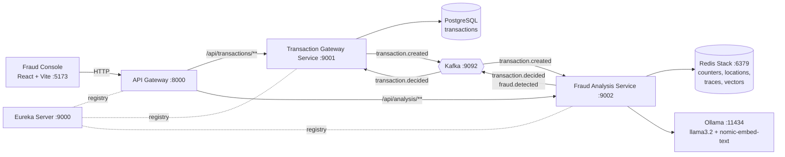

# Fraud Transaction Detection

A microservices system that receives credit card transactions, checks each one for fraud in real time, and explains every decision. Cheap rule checks run first (swipe frequency and impossible travel). Anything that passes them is judged by a local LLM that is shown relevant fraud knowledge retrieved from a vector database (RAG). A React console shows each transaction and, for every one, exactly which check passed or failed and why.

## Contents

1. [Features](#features)
2. [Architecture](#architecture)
3. [Tech stack](#tech-stack)
4. [Project structure](#project-structure)
5. [How a transaction flows](#how-a-transaction-flows)
6. [The fraud checks](#the-fraud-checks)
7. [The AI layer (RAG)](#the-ai-layer-rag)
8. [Decision traces](#decision-traces)
9. [Services and key classes](#services-and-key-classes)
10. [Frontend (Fraud Console)](#frontend-fraud-console)
11. [API reference](#api-reference)
12. [Kafka topics and data stores](#kafka-topics-and-data-stores)
13. [Getting started](#getting-started)
14. [Trying it out](#trying-it-out)
15. [Troubleshooting](#troubleshooting)
16. [Security notes](#security-notes)
17. [Limitations and next steps](#limitations-and-next-steps)

---

## Features

- **Asynchronous pipeline.** The API answers immediately; fraud analysis happens afterwards over Kafka.
- **Three layered checks.** Velocity (too many swipes), geolocation (impossible travel), and an AI anomaly check.
- **RAG with a vector database.** The AI is given similar past cases and fraud rules, retrieved from Redis Stack vector search.
- **A learning loop.** Transactions flagged by the rules are saved back into the knowledge base as new cases.
- **Full explainability.** Every transaction gets a step-by-step trace: what each check saw, what it decided, what the AI was shown, and what it answered.
- **Privacy-minded events.** Raw card numbers are never stored or sent over Kafka. Only a masked number and a hash are used.
- **Service discovery and a single entry point.** Eureka plus a Spring Cloud Gateway.

## Architecture



| Service | Port | Responsibility |
|---|---|---|
| **Eureka Service** | 9000 | Service registry. Every other service registers here. |
| **API Gateway** (`Gateway-Service`) | 8000 | Single entry point. Routes requests to services by name, handles CORS for the frontend. |
| **Transaction Gateway Service** | 9001 | Accepts and validates transactions, stores them in PostgreSQL, publishes them to Kafka. |
| **Fraud Analysis Service** | 9002 | Consumes transactions, runs the fraud checks, records decision traces, publishes results. |
| **Frontend** | 5173 | React console for submitting swipes and inspecting decisions. |

Infrastructure: Kafka and Redis Stack run in Docker. PostgreSQL and Ollama run locally.

## Tech stack

| Area | Technology |
|---|---|
| Language and build | Java 21, Maven (wrapper included) |
| Framework | Spring Boot 4.1.1, Spring Cloud 2025.1.3 (Eureka, Gateway Server WebMVC) |
| Messaging | Apache Kafka (Docker image `apache/kafka:3.7.0`, KRaft mode, no ZooKeeper), Spring for Apache Kafka |
| Database | PostgreSQL with Spring Data JPA (Hibernate) |
| Cache and vector store | Redis Stack (RediSearch vector search) via Jedis |
| AI | Spring AI 2.0.1, Ollama running `llama3.2` (chat) and `nomic-embed-text` (embeddings) |
| Frontend | React 19, Vite 8, plain CSS, oxlint |
| Utilities | Lombok, Jackson |

## Project structure

```
FraudTransaction/
├── docker-compose.yml                 Kafka + Redis Stack
├── Eureka-Service/                    Service registry
├── Gateway-Service/                   API gateway (routing, CORS)
├── Transaction-Gateway-Service/       REST API, PostgreSQL, Kafka producer
├── Fraud-Analysis-Service/            Fraud checks, RAG, traces
│   └── src/main/java/com/transaction/analysis/
│       ├── ai/service/                AnomalyDetectionService, TransactionDescriber,
│       │                              FraudKnowledgeLoader, FraudCaseMemoryService
│       ├── kafka/                     consumer, producers, event classes, config
│       ├── model/                     FraudDecision, TraceStep, DecisionTrace
│       ├── redis/                     VelocityCheckService, GeolocationCheckService, RedisConfig
│       ├── service/                   FraudAnalysisService (the pipeline)
│       └── trace/                     TraceStore, TraceController
└── Frontend/                          React console
    └── src/
        ├── api/                       transactions.js, traces.js
        ├── components/                SwipeForm, Ledger, TraceTimeline, PipelineDots,
        │                              DecisionLog, StatusPill
        ├── lib/trace.js               labels and formatting helpers
        └── App.jsx, App.css, Trace.css, index.css
```

## How a transaction flows

1. **Submit.** The console sends `POST /api/transactions` to the API Gateway (port 8000), which routes it to the Transaction Gateway Service.
2. **Validate and store.** The request is validated (16-digit card, positive amount, 3-letter currency, location required). The card number is masked (`4111-XXXX-XXXX-1234`) and hashed with SHA-256. The transaction is saved in PostgreSQL with status `PENDING`, and the API returns `201 Created` right away.
3. **Publish.** A `transaction.created` event is sent to Kafka. It contains the masked number and the hash, never the raw card number.
4. **Analyze.** The Fraud Analysis Service consumes the event and runs the pipeline: velocity, then geolocation, then the AI check. It stops at the first failure.
5. **Record.** The full decision trace is saved to Redis before anything is published.
6. **Publish results.** A `transaction.decided` event carries the final status (`APPROVED` or `FLAGGED`), and a `fraud.detected` event is also sent for flagged transactions. The Transaction Gateway Service uses the decision to update the transaction's status in PostgreSQL.
7. **Learn.** If a rule (not the AI) flagged the transaction, it is saved as a new case in the vector store.
8. **Display.** The console polls for a short while after each swipe, then shows the final status and the full timeline.

## The fraud checks

Checks run cheapest first, and the pipeline stops at the first failure. Later checks are shown as "skipped" in the trace.

| Order | Check | Rule | Reason code on failure |
|---|---|---|---|
| 1 | **Velocity** | More than 3 transactions on the same card within 60 seconds. | `VELOCITY_EXCEEDED` |
| 2 | **Geolocation** | The distance from the card's previous location, divided by the time elapsed, implies a speed above 900 km/h (roughly airliner speed). Distance uses the haversine formula. | `IMPOSSIBLE_TRAVEL` |
| 3 | **AI anomaly** | The LLM, shown relevant knowledge, answers `FRAUD`. | `AI_ANOMALY` |

How the rules keep state in Redis, keyed by the card hash:

- `velocity:{hash}` is a counter with a 60-second expiry that starts on the first swipe in a window.
- `location:{hash}` holds the last location and timestamp for 24 hours. It is always updated with the newest swipe.

The AI check is the slowest step (the first call can take around 10 seconds while the model loads), which is why the rules run before it.

If the AI call itself fails (for example Ollama is not running), the transaction is approved by the rules alone and the trace shows an `ERROR` step. Change the `catch` block in `FraudAnalysisService` if you prefer to fail closed.

## The AI layer (RAG)

**RAG** means Retrieve, Augment, Generate: instead of asking the LLM about a transaction cold, the system first looks up relevant knowledge and includes it in the prompt.

### Key ideas

- **Embedding.** A model (`nomic-embed-text`) turns text into a vector of numbers. Texts with similar meaning get similar vectors.
- **Vector database.** Redis Stack stores those vectors and finds the closest ones to a query. It uses the search index `fraud-kb` and the key prefix `fraud-kb:`.
- **LLM.** `llama3.2` runs locally through Ollama, with temperature 0.2 for more consistent answers.

### What happens in the AI step

1. `TransactionDescriber` turns the transaction into words, for example: `very high amount purchase (48000 INR) at merchant MERCH-731, late night`. Embeddings are poor at comparing raw numbers, so amounts and times are bucketed into words:
   - Amount: small (under 500), moderate (under 5,000), high (under 20,000), very high (20,000 and above).
   - Time of day (India time): late night (before 05:00), morning, afternoon, evening.
2. **Retrieve.** That description is used to search the vector store for the 8 most similar entries.
3. **Balance.** The service keeps up to 2 fraud cases and up to 2 other entries (rules or legitimate cases). This stops fraud cases from crowding out everything else.
4. **Augment.** The kept entries go into the prompt, with notes telling the model that past cases may have been flagged for unrelated reasons and that it should answer `LEGIT` if nothing clearly suggests fraud.
5. **Generate.** The model replies with one word, `FRAUD` or `LEGIT`. The reply is accepted if it starts with `FRAUD`.

### The knowledge base

`FraudKnowledgeLoader` seeds it at startup with fixed document IDs, so restarts overwrite rather than duplicate:

| Type | Examples |
|---|---|
| `RULE` | Card testing patterns, very high late-night amounts, normal small recurring purchases |
| `CASE` (seed) | A confirmed fraud case and a confirmed legitimate case |
| `CASE` (learned) | Added automatically at runtime, see below |

### The learning loop

When a transaction is flagged by the **velocity or geolocation rule**, `FraudCaseMemoryService` saves it as a new case such as `Case: small amount purchase (82.9 INR) at merchant MERCH-942, afternoon. Flagged as FRAUD because: more than 3 purchases within 60 seconds (not human-confirmed)`. Future similar transactions can retrieve it as evidence.

Two deliberate design choices:

- **AI flags are not saved.** If the model's own guesses became evidence, its mistakes would reinforce themselves. Only deterministic rule hits are learned from.
- **The text states the real reason.** A velocity case should not teach the model that "small amounts are fraud", so the case text says why it was flagged.

Cases are labelled "not human-confirmed". A human review step is a natural next feature.

## Decision traces

Every transaction gets a trace: a record of everything the pipeline did. It is built step by step inside `FraudAnalysisService`, saved by `TraceStore`, and served by `TraceController`.

Each step has a stage (`VELOCITY`, `GEOLOCATION`, `AI`), a status (`PASS`, `FAIL`, `SKIPPED`, `ERROR`), a plain-language summary, and details. Example for a transaction that failed the geolocation check:

```json
{
  "transactionId": "4029574b-6ce8-4b5e-ab93-c6f9db1c59ec",
  "verdict": "FLAGGED",
  "reason": "IMPOSSIBLE_TRAVEL",
  "durationMs": 14,
  "steps": [
    {
      "stage": "VELOCITY", "status": "PASS",
      "summary": "Swipe #3 in the last 60 seconds (limit is 3)"
    },
    {
      "stage": "GEOLOCATION", "status": "FAIL",
      "summary": "Moved 14,113 km in 9s, which implies 5,645,142 km/h (limit is 900 km/h)",
      "details": { "Distance from last swipe (km)": 14112.9, "Implied speed (km/h)": 5645142 }
    },
    {
      "stage": "AI", "status": "SKIPPED",
      "summary": "Not run because the geolocation check already failed"
    }
  ]
}
```

For the AI step the details include the search text, the knowledge entries retrieved (labelled rule, fraud case or legit case), and the model's raw answer.

Traces are stored in Redis as plain JSON strings (`trace:{transactionId}`, kept 7 days) with a list of the 200 most recent IDs (`traces:recent`).

## Services and key classes

### Eureka Service (port 9000)
- `EurekaApplication` starts the Eureka server (`@EnableEurekaServer`). It does not register with itself.

### API Gateway (port 8000)
- `application.yml` defines routes: `/api/transactions/**` goes to `TRANSACTION-GATEWAY-SERVICE`, and `/api/analysis/**` goes to `FRAUD-ANALYSIS-SERVICE` (resolved through Eureka with `lb://`).
- `SecurityConfig` allows all requests, disables CSRF, and enables CORS for `http://localhost:5173` and `http://127.0.0.1:5173`.

### Transaction Gateway Service (port 9001)
- `TransactionController`: `POST /api/transactions` (create) and `GET /api/transactions` (list all).
- `TransactionService`: `processTransaction` validates, masks, hashes, saves, and publishes; `getTransactions` lists; `maskCardNumber` and `hashCardNumber` protect the card.
- `TransactionRequest` and `TransactionResponse`: input validation and output shape.
- `Transaction`: the JPA entity with status `PENDING`, `APPROVED`, `FLAGGED` or `REJECTED`.
- `TransactionRepository`: Spring Data JPA repository.
- `TransactionProducer`: publishes `TransactionCreatedEvent` to `transaction.created`, keyed by transaction ID.
- `KafkaProducerConfig`: JSON serialization with Java time support, idempotent producer, `acks=all`.
- `GlobalExceptionHandler`: returns `400` with per-field messages for validation errors.

### Fraud Analysis Service (port 9002)
- `TransactionConsumer`: the Kafka listener on `transaction.created`. It runs the analysis, records the trace, publishes events, and triggers learning.
- `FraudAnalysisService.analyze`: the pipeline. Runs the checks in order and builds the trace.
- `VelocityCheckService.check` and `GeolocationCheckService.check`: the two rule checks, backed by Redis.
- `AnomalyDetectionService.analyze`: the RAG step (retrieve, balance, prompt, parse).
- `TransactionDescriber`: turns a transaction into searchable text.
- `FraudKnowledgeLoader`: seeds the vector store at startup.
- `FraudCaseMemoryService`: saves rule-flagged transactions as new cases.
- `TraceStore` and `TraceController`: save and serve decision traces.
- `FraudEventProducer` and the decision producer: publish `fraud.detected` and `transaction.decided`.
- `KafkaConsumerConfig`, `KafkaProducerConfig`, `RedisConfig`: serialization and connection setup.
- Models: `FraudDecision`, `TraceStep`, `DecisionTrace`, `LocationSnapshot`, and the Kafka event classes.

## Frontend (Fraud Console)

Built with React and Vite, in a dark theme.

- **Swipe form** (`SwipeForm.jsx`): validates input like the backend does. "Fill sample" generates a random valid swipe. Scenario buttons prepare test cases: **Normal purchase**, **Big spend**, **Swipe in Mumbai** (same card, far-away location), and **Send 5 quickly** (trips the velocity rule).
- **Ledger** (`Ledger.jsx`): every transaction with time, merchant, amount, status, the reason, and three pipeline dots.
- **Pipeline dots** (`PipelineDots.jsx`): V (velocity), G (geolocation), AI. Green is passed, red is failed, dashed is skipped, amber is an error, and a pulsing dot means still waiting.
- **Timeline** (`TraceTimeline.jsx`): click any row to see every step with its numbers. For the AI step it shows the retrieved knowledge and the model's raw answer.
- **Decision log** (`DecisionLog.jsx`): a second tab listing every decision, newest first, each with its full timeline.
- **Live updates**: after each submit, the page refreshes every 2.5 seconds for up to 90 seconds, and stops early once nothing is waiting. The Refresh button reloads manually.

The API base URLs are set in `src/api/transactions.js` and `src/api/traces.js` (both point at the gateway on port 8000).

## API reference

All requests go through the API Gateway on `http://localhost:8000`.

### Create a transaction

`POST /api/transactions`

```json
{
  "cardNumber": "4111111111111234",
  "amount": 450.00,
  "merchantId": "MERCH-102",
  "currency": "INR",
  "latitude": 31.6340,
  "longitude": 74.8723
}
```

Response `201 Created` (the status starts as `PENDING`):

```json
{
  "transactionId": "f5c9a832-0624-4ac1-b32f-61bd629d9c19",
  "amount": 450.00,
  "merchantId": "MERCH-102",
  "status": "PENDING",
  "timestamp": "2026-10-25T09:32:04Z"
}
```

Validation failure returns `400` with the field names and messages:

```json
{
  "timestamp": "2026-10-25T09:32:04Z",
  "status": 400,
  "error": "Validation Failed",
  "fieldErrors": { "cardNumber": "Card number must be 16 digits" }
}
```

### List transactions

`GET /api/transactions` returns all stored transactions, including their current status.

### Decision traces

- `GET /api/analysis/traces?limit=50` returns the most recent traces, newest first (maximum 200).
- `GET /api/analysis/traces/{transactionId}` returns one trace, or `404` if there is none.

## Kafka topics and data stores

| Topic | Producer | Consumer | Content |
|---|---|---|---|
| `transaction.created` | Transaction Gateway Service | Fraud Analysis Service | New transaction (masked card, card hash, amount, merchant, location, time) |
| `transaction.decided` | Fraud Analysis Service | Transaction Gateway Service | Final status for a transaction |
| `fraud.detected` | Fraud Analysis Service | none yet | Flagged transaction with the reason. Reserved for a future alert service. |

| Store | What is in it |
|---|---|
| **PostgreSQL** (`Transaction-Fraud-Detection-App`) | The `transactions` table, created and updated by Hibernate (`ddl-auto: update`) |
| **Redis: counters** | `velocity:{cardHash}` (60 s), `location:{cardHash}` (24 h) |
| **Redis: traces** | `trace:{transactionId}` (7 days), `traces:recent` (list of 200) |
| **Redis: vectors** | `fraud-kb:*` documents under the `fraud-kb` search index |

## Getting started

### Prerequisites

- **Java 21** and Maven (each service includes `mvnw`, so Maven itself is optional)
- **Node.js** 20.19+ or 22.12+ (required by Vite 8)
- **Docker** (for Kafka and Redis Stack)
- **PostgreSQL** running on port 5432
- **Ollama** ([ollama.com](https://ollama.com))

### 1. Start Kafka and Redis

```bash
docker compose up -d
```

Redis Stack also serves RedisInsight at http://localhost:8001, a handy way to inspect keys and vectors.

### 2. Set up PostgreSQL

Create the database named in `Transaction-Gateway-Service/src/main/resources/application.yml`:

```sql
CREATE DATABASE "Transaction-Fraud-Detection-App";
```

Update the username and password in that file to match your local setup. The table is created automatically on first start.

### 3. Set up Ollama

```bash
ollama pull llama3.2
ollama pull nomic-embed-text
```

Make sure Ollama is running (it listens on port 11434).

### 4. Start the backend services, in this order

Open one terminal per service. On Windows use `mvnw.cmd` instead of `./mvnw`.

```bash
# 1. Service registry (port 9000)
cd Eureka-Service && ./mvnw spring-boot:run

# 2. Transaction Gateway Service (port 9001)
cd Transaction-Gateway-Service && ./mvnw spring-boot:run

# 3. Fraud Analysis Service (port 9002)
cd Fraud-Analysis-Service && ./mvnw spring-boot:run

# 4. API Gateway (port 8000)
cd Gateway-Service && ./mvnw spring-boot:run
```

Check http://localhost:9000 to confirm the three services have registered with Eureka. On startup, the Fraud Analysis Service logs `Loaded 5 documents into the fraud knowledge base`.

### 5. Start the frontend

```bash
cd Frontend
npm install
npm run dev
```

Open http://localhost:5173.

### Ports at a glance

| Port | What |
|---|---|
| 5173 | Frontend |
| 8000 | API Gateway |
| 9000 | Eureka |
| 9001 | Transaction Gateway Service |
| 9002 | Fraud Analysis Service |
| 9092 | Kafka |
| 6379 / 8001 | Redis / RedisInsight |
| 5432 | PostgreSQL |
| 11434 | Ollama |

## Trying it out

Use the scenario buttons in the console, then click the resulting row to read the timeline.

| Scenario | What to do | Expected result |
|---|---|---|
| Normal purchase | Click **Normal purchase**, then **Run transaction** | Passes all checks. The AI usually answers `LEGIT`. |
| Burst | Click **Send 5 quickly** | The first three can pass. The 4th and 5th fail velocity, and the other checks are skipped. |
| Impossible travel | Run a normal purchase, then click **Swipe in Mumbai** (same card) and run it | Geolocation fails with an implied speed far above 900 km/h. The AI step is skipped. |
| Big spend | Click **Big spend** and run it | Passes the rules, so the AI decides. See which knowledge it was shown and what it answered. |

To check the vector store, open RedisInsight and look for `fraud-kb:` keys. After a rule-flagged transaction, a new `fraud-kb:case-...` key should appear.

## Troubleshooting

| Problem | Cause and fix |
|---|---|
| `JedisConnectionFactory` bean not found at startup | The vector store needs the Jedis client. Add the `redis.clients:jedis` dependency and set `spring.data.redis.client-type: jedis`. |
| `LinkedHashMap cannot be cast to LocationSnapshot` | Redis returns generic maps. `GeolocationCheckService` converts with `ObjectMapper.convertValue` instead of casting. |
| Fraud Analysis Service fails when the AI step runs | Make sure Ollama is running and both models are pulled. |
| Transactions stay `PENDING` | The analysis service was down or crashed on that event. Check its logs and resend the transaction. |
| Console shows "Decision details unavailable" | The gateway has no `/api/analysis/**` route, or the Fraud Analysis Service is not registered in Eureka. |
| First AI check takes about 10 seconds | Ollama is loading the model. Later calls are much faster. |
| `UNKNOWN_TOPIC_OR_PARTITION` warning once | Kafka auto-creates topics on first publish. It retries and succeeds. |
| Old rows show "Analyzing…" | They were created before decision traces existed. Only new transactions get a trace. |

## Security notes

This is a learning project, not production-ready. Before using it for anything real:

- **Secrets in config.** The database password is in `application.yml`. Move it to an environment variable or a secrets manager.
- **No authentication.** The gateway allows all requests. Add real authentication and authorization.
- **Card hashing.** Card numbers are hashed with plain SHA-256. A 16-digit space is small enough to brute-force, so a production system should use a keyed hash (HMAC) with a secret, or tokenization. Real systems also avoid handling raw card numbers at all.
- **Network.** CORS is limited to the local frontend, and Kafka and Redis have no authentication.

## Limitations and next steps

**Known limitations**

- The AI is a small local model. Its answers can vary between runs, so treat `AI_ANOMALY` as "needs a second look" rather than a verdict.
- The AI cannot see swipe frequency, because the prompt does not include velocity data. Only the rules know that.
- Learned cases are not human-confirmed, and the knowledge base grows without bound.
- When velocity fails first, the geolocation check does not run, so the stored last location is not updated for that swipe.
- There are no automated tests beyond Spring context-load tests.

**Ideas for next steps**

- A human review screen to confirm or reject flagged transactions, feeding confirmed cases back into the knowledge base.
- Ask the model for a confidence score and use it to separate `FLAGGED` (review) from `REJECTED` (block).
- Pass the velocity count and recent history into the AI prompt.
- Filter vector searches by metadata (case type, outcome).
- An alert service that consumes `fraud.detected`, and live updates to the console over SSE or WebSockets instead of polling.
- Containerize every service in `docker-compose.yml`, and add unit and integration tests.
